Evidence mode B: one design document. The pain points count as team reports (E3). I had no code, IaC or metrics, so findings are graded E2 and anything I inferred is marked E4.
Plan: rebuild the system from the overview, test it against the 99.9% contract and the 10× tenant goal, score 10 dimensions, and draw every diagram the document supports.
Quick depth, so the report covers sections 1, 4, 5, 9 and 12.

---

# Architecture review: Parcelly

## 1. Executive summary

**Verdict: not fit for purpose (1.7 / 5).** Parcelly runs today, but as built it can't keep its 99.9% uptime contract and won't reach 400 tenants. Most of the gap can be closed with configuration changes and a few weeks of focused work. It doesn't need a rebuild.

**Top 3 risk themes**
1. **Availability and durability.** Postgres and Redis each run as a single copy in one availability zone, and nobody has ever restored a backup. One zone outage would use up the 43-minute monthly downtime allowance many times over (F-01).
2. **Tenant trust.** The only thing keeping tenants apart is the `WHERE tenant_id` clause in each handler. One shared secret signs every token, admin tokens included (F-02, F-03).
3. **Silent loss and one growth ceiling.** Webhooks are dropped after 5 retries and nobody is alerted. That's the likely cause of the biggest tenant's complaint (F-04). The same Postgres instance also takes unbounded GPS inserts and dashboard polls every 5 seconds (F-05, F-07).

**Top 3 strengths:** a monolith sized for a 4-person team (F-11), managed AWS services throughout (F-12), and stateless compute across 2 zones with a worker and queue that the fixes can reuse (F-13, F-14).

**Most important action:** this month, turn on RDS Multi-AZ, add a Redis replica, then run a restore drill and time it.

**Parameters:** depth=quick · focus_dimensions=all · diagrams=all (14 drawn as 15 figures, 2 skipped) · diagram_engine=mermaid · output_format=markdown · destination=chat · audience=engineering · severity_threshold=low · max_findings=10 (quick) · deliverables=report · baseline=none · redact=false · scoring_weights=derived · roadmap_capacity=assumed 25% of 4 engineers, about 1 engineer · language=English

**Assumptions (used only in estimates):** drivers are active about 10 hours a day. A delivery changes status about 4 times. Each tenant has about 2 dashboards open. A location row takes about 150 bytes including its index. Tenants configure their own webhook URLs. The JWT secret is set as a plain ECS `environment` value, not through ECS `secrets`.

**Unknowns that could change conclusions:**
- Whether the nightly snapshots include point-in-time recovery.
- BullMQ retry delays.
- The Twilio timeout.
- Which indexes exist on `deliveries`.
- Whether the Redis sessions can revoke JWTs.
- The delivery status lifecycle.
- How rollbacks and migrations are handled.

## 4. Scorecard

The weights come from four scenarios rated high importance and high difficulty:
- **QA1:** 99.9% monthly availability (D7, D8).
- **QA2:** no cross-tenant data access (D9, D8).
- **QA3:** 10× more tenants without slowdown (D6, D8, D14).
- **QA4:** every status change reaches the tenant (D4, D7, D12).

| Dimension | Weight | Score (0–5) | Confidence | Cap applied? | Rationale |
|---|---|---|---|---|---|
| D1 Style and structural fit | 4 | 3.5 | Medium | No | One API service plus one worker fits a single team of 4 |
| D4 Event-driven (BullMQ) | 10 | 1.5 | High | High, max 2.5 (not binding) | Two separate writes with no outbox, drop after 5 retries, no dead-letter queue (DLQ), no alerts (F-04) |
| D6 Scalability and performance | 15 | 2.0 | Medium | High, max 2.5 | Compute scales out. One Postgres absorbs unbounded GPS writes and 5-second polls (F-05, F-07, F-09) |
| D7 Reliability and resilience | 18 | 1.0 | High | Critical, max 1.5 | Single-AZ database, single Redis node, untested restore, all under a 99.9% contract (F-01, F-06) |
| D8 Data and tenancy | 14 | 2.0 | Medium | High, max 2.5 | Pooled model is right. Isolation lives in app code only (F-02). No retention policy (F-05) |
| D9 Security and Zero Trust | 16 | 1.5 | Medium | High, max 2.5 | One shared secret mints any token, admin included, valid 24 hours with no revocation (F-03, F-10) |
| D10 API and integration | 6 | 2.0 | Low, provisional | No | Full-list polling, no rate limits, no defined webhook contract |
| D12 Observability | 9 | 1.5 | High | No | Plain-text logs, host alarms only, failures not alerted, SLA not measured (F-08) |
| D13 Delivery and governance | 5 | 2.5 | Low, provisional | No | CI/CD to ECS exists. Rollback, migrations and tests aren't documented |
| D14 Cost efficiency | 3 | 2.5 | Low, provisional | No | Small managed footprint. No cost per tenant, and GPS storage grows forever |
| D2 Domain modeling, D11 Code design | – | not scored | – | – | No code or domain docs |
| D3 Microservices, D5 CQRS/ES, D15 AI, D16 Compliance | N/A | – | – | – | Not distributed services, no CQRS, no AI parts, no compliance scope stated. Driver GPS is still personal data (see F-05) |

**Overall: 1.7 / 5. Not fit for purpose:** the score is below 2.5, and one Critical finding is open.

```
D1  Style          ███▌░ 3.5
D4  Event-driven   █▌░░░ 1.5
D6  Scalability    ██░░░ 2.0
D7  Reliability    █░░░░ 1.0
D8  Data/tenancy   ██░░░ 2.0
D9  Security       █▌░░░ 1.5
D10 API            ██░░░ 2.0
D12 Observability  █▌░░░ 1.5
D13 Delivery       ██▌░░ 2.5
D14 Cost           ██▌░░ 2.5
```

## 5. Findings

### Diagrams

**Figure 1: System context** · Partly inferred · Sources: [Overview §Business], [§Main flows], [§Security]

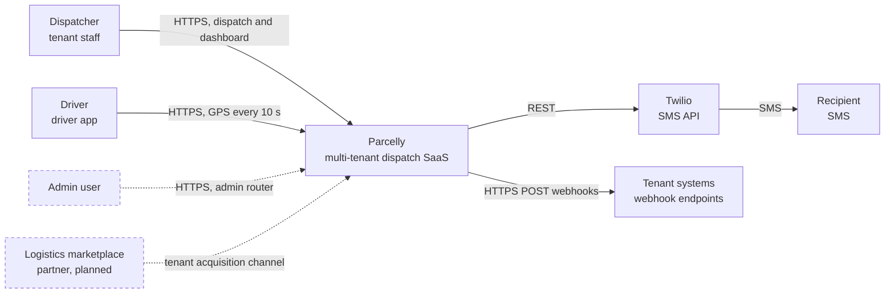

**Figure 2: Containers and findings map** · Evidenced · Sources: [Overview §Stack and deployment], [§Main flows], [§Observability]

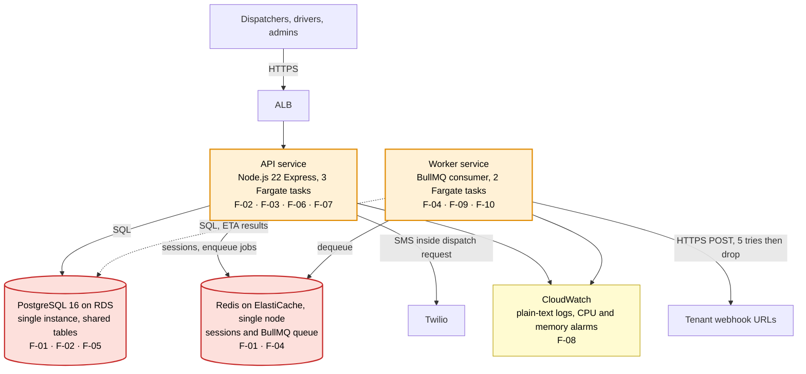

Red is Critical, amber is High, yellow is Medium. Dashed means inferred.

**Figure 3: API service components** · Partly inferred · Sources: [Overview §Main flows], [§Security]

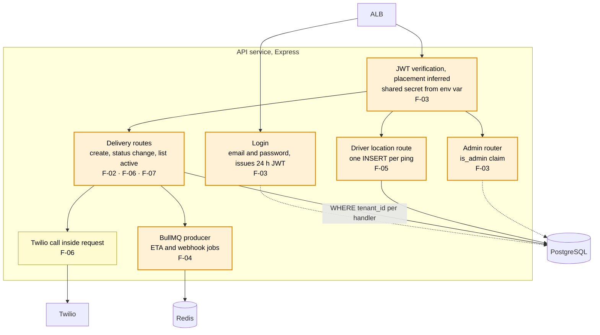

**Figure 4: Deployment** · Partly inferred · Sources: [Overview §Stack and deployment], [§Security], [§Observability]

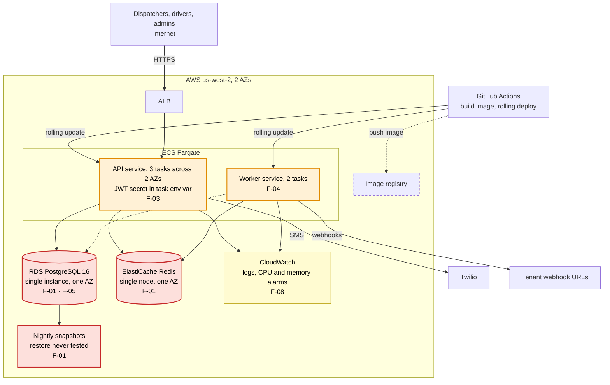

**Figure 5: Dispatch flow** · Partly inferred · Sources: [Overview §Main flows 1], [§Observability]

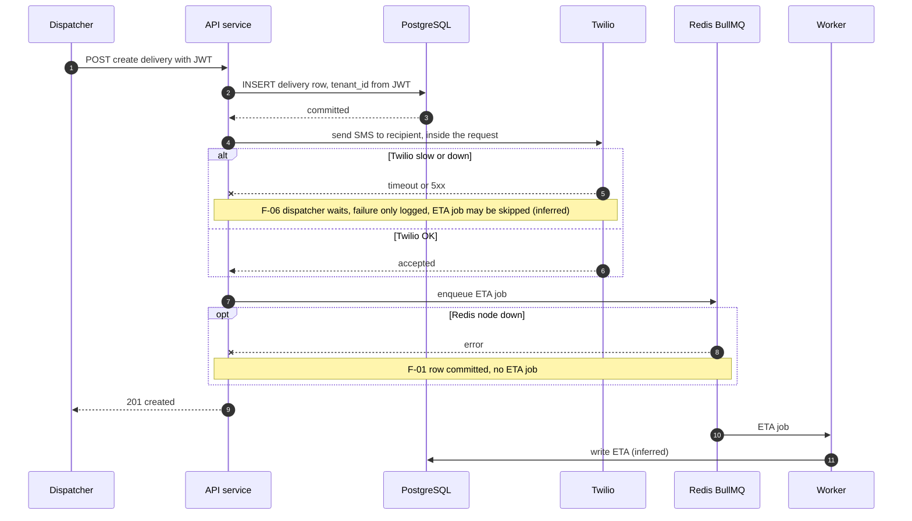

**Figure 6: Status change and webhook flow** · Partly inferred · Sources: [Overview §Main flows 3], [§Known pain points]

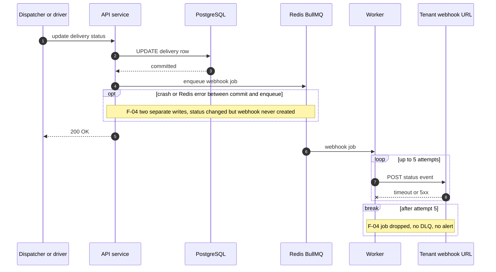

**Figure 7: Driver location ingest and dashboard polling** · Partly inferred · Sources: [Overview §Main flows 2 and 4], [§Known pain points]

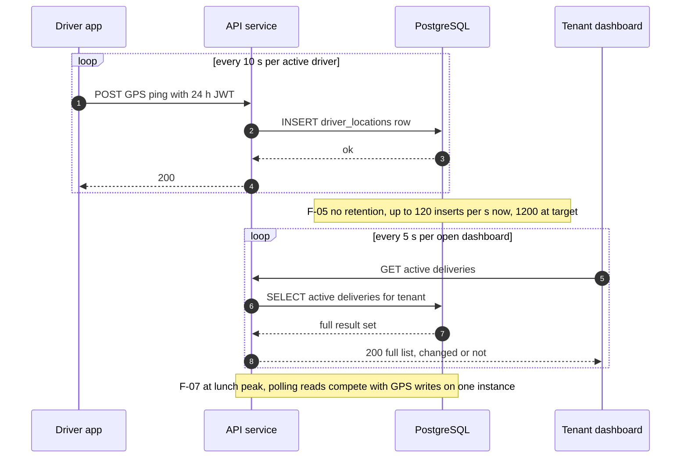

**Figure 8: Data model** · Partly inferred · Sources: [Overview §Stack and deployment], [§Main flows], [§Security]. The documented items are: shared tables with `tenant_id`, `deliveries` with a status, `driver_locations` with one row per ping, email and password login, and the `is_admin` claim. The column types and the user/driver relations are inferred (dashed). All tables belong to the API service, and the worker uses them too.

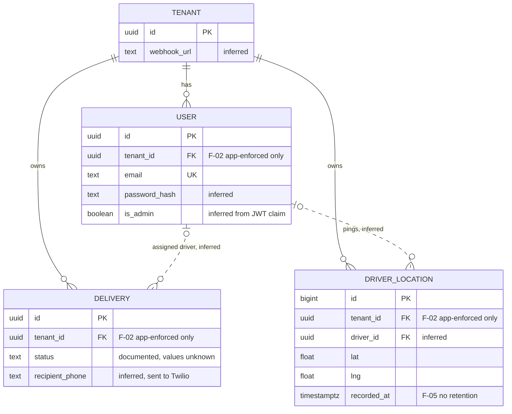

**Figure 9: Trust boundaries** · Partly inferred · Sources: [Overview §Security], [§Main flows], [§Stack and deployment]

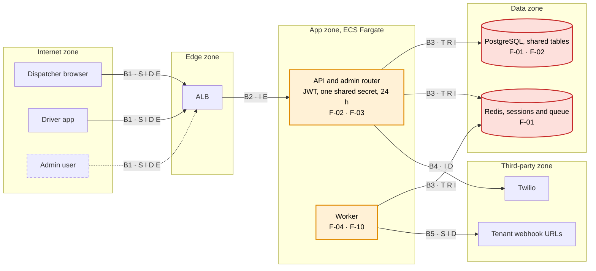

STRIDE letters: S spoofing, T tampering, R repudiation, I information disclosure, D denial of service, E elevation of privilege.

| Crossing | STRIDE | Why |
|---|---|---|
| B1 Internet to ALB | S I D E | Password-only login. 24-hour bearer tokens on phones. No rate limits. A leaked secret lets anyone mint an admin token |
| B2 ALB to API | I E | Authorization is checked only in handlers. Whether a driver token can reach dispatcher or admin routes isn't documented. Internal TLS isn't documented |
| B3 App to data | T R I | Any missing `tenant_id` filter reads or writes another tenant's rows. No audit trail is documented |
| B4 API to Twilio | I D | Recipient phone numbers leave the system. A Twilio outage slows or breaks dispatch |
| B5 Worker to tenant URLs | S I D | Payload signing isn't documented. The worker could POST to internal addresses (SSRF). Slow endpoints tie up workers |

**Figure 10: Event topology** · Partly inferred · Sources: [Overview §Main flows 1 and 3], [§Stack and deployment]

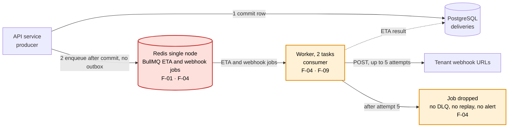

**Figure 11: Tenancy isolation by layer** · Partly inferred · Sources: [Overview §Stack and deployment], [§Security], [§Business]. The document mentions no object storage or search index, so neither is drawn.

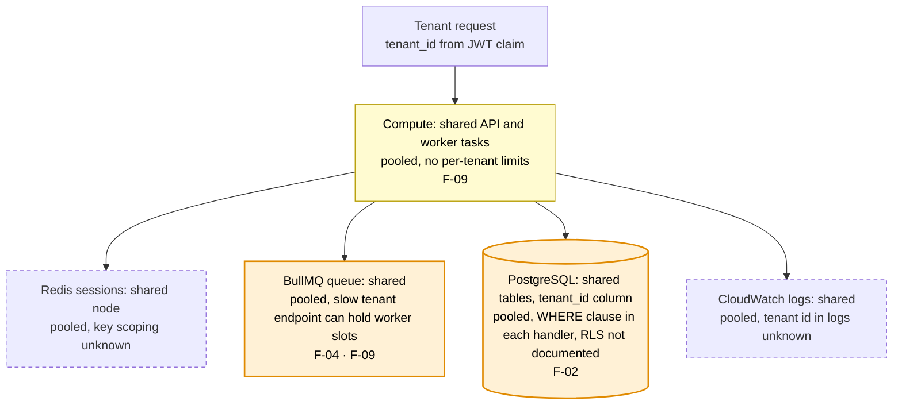

**Figure 12: Risk quadrant** · Evidenced · Sources: findings F-01 to F-10

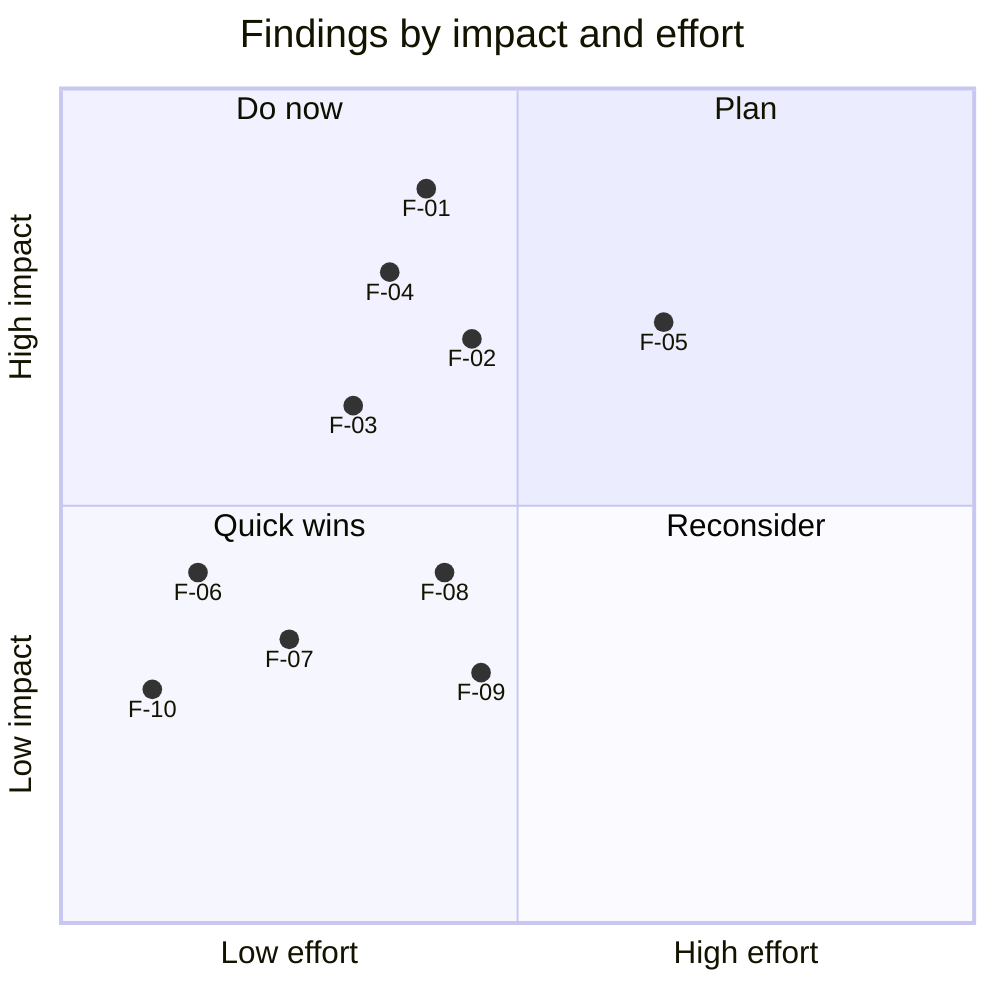

**Figure 13: Scorecard** · Evidenced · Sources: section 4

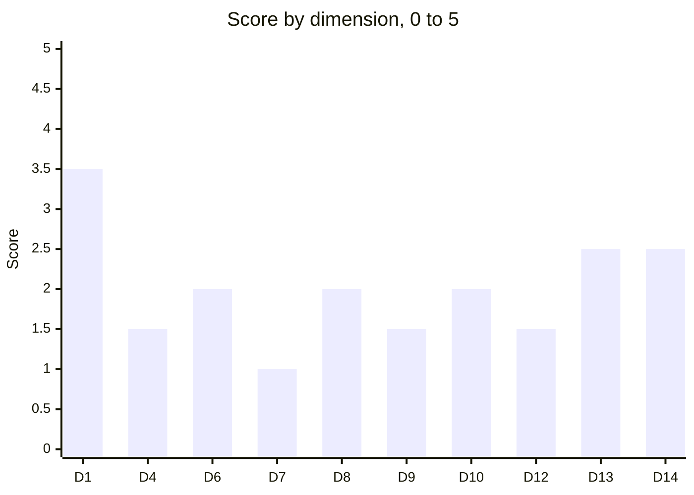

**Figure 14: Remediation roadmap** · Inferred · Sources: findings and assumed capacity of about 1 engineer. Now runs about 4 weeks and Next about 2 months. F-09 moved to Later because it doesn't fit.

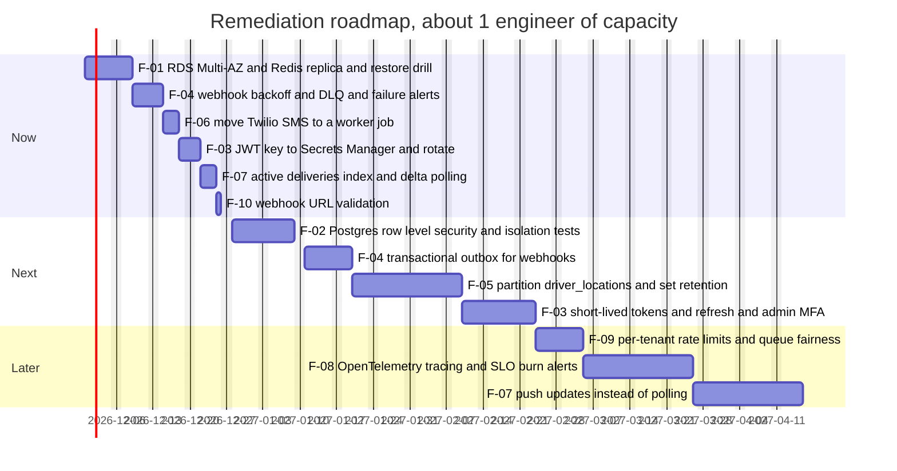

**Figure 15: Current vs target** · Partly inferred · Sources: findings F-01 to F-10. Changed parts are blue.

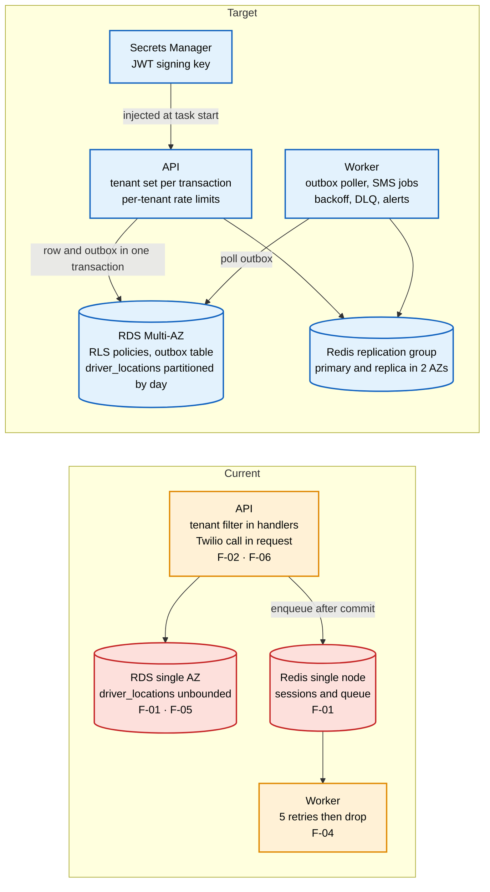

**Diagrams not drawn**
- `state_machines`: the document names no delivery status except `active`, so a lifecycle would be invented.
- `module_graph`: no code access.

---

### [F-01] The data tier has no redundancy, and the restore path is untested
- Dimension: D7 | Severity: Critical | Confidence: High
- Evidence (E2): [Overview §Stack and deployment] says RDS is a "single instance (not Multi-AZ)" and "A restore has never been tested". Redis is a "single node" holding sessions and the BullMQ queue.
- Observation: every request and every job depends on one Postgres instance in one zone and one Redis node. Compute runs in 2 zones, but the data doesn't.
- Impact: 99.9% a month allows 43.8 minutes of downtime.
  - Single-AZ RDS maintenance and instance failures eat into that budget.
  - A zone outage means restoring a snapshot into another zone. Nobody has run that procedure, and the database grows every day (F-05). Expect hours, which breaches the contract for all 40 tenants.
  - Losing the Redis node drops every queued ETA and webhook job and every session.
  - The recovery point depends on whether the "nightly snapshots" are RDS automated backups with point-in-time recovery (about 5 minutes of loss) or snapshots only (up to 24 hours). The document doesn't say.
- Root cause: the defaults from the early days were never revisited when the 99.9% promise was made.
- Recommendation:
  - Turn on RDS Multi-AZ. Failover typically takes 1–2 minutes.
  - Move Redis to a replication group with a replica in the second zone and automatic failover.
  - Confirm point-in-time recovery is on.
  - Run a timed restore into a scratch instance now, then every quarter, and write down the recovery time and recovery point you get.
  - Keep `maxmemory-policy noeviction`, which BullMQ requires, and alarm on memory, because sessions share the node.
- Alternatives & trade-offs:
  - Aurora PostgreSQL fails over faster and replicates at the storage layer. It costs more and needs a migration, which isn't justified yet.
  - Separate Redis nodes for sessions and the queue would isolate memory pressure, at the cost of one more node to run. Do it if memory alarms fire.
  - Multi-AZ roughly doubles the RDS instance bill. That's cheap next to one contract breach.
- Effort: M | Reversibility: two-way
- Verification:
  - In a forced RDS failover test, the API error rate is back to baseline within 3 minutes.
  - The restore drill finishes within a written recovery-time target.
  - In staging, a Redis primary failover loses zero queued jobs.

### [F-02] Tenant isolation is enforced only in application code
- Dimension: D8 | Severity: High | Confidence: High
- Evidence (E2): [Overview §Security] "Each route handler scopes queries with `WHERE tenant_id = $1`". [§Stack and deployment] "All tenants share tables with a `tenant_id` column".
- Observation: isolation is a convention that every handler has to repeat. The database will return any tenant's rows to a query that forgets the clause. No isolation tests are documented.
- Impact: one missing clause in a new endpoint, a report or an admin path leaks one tenant's data to another (OWASP API1, broken object-level authorization). That data includes recipient phone numbers, delivery addresses (inferred) and driver locations. The chance of a miss rises as the codebase grows and the tenant count goes up 10×. A marketplace partner will probably ask about isolation before signing.
- Root cause: the pooled model was the right choice, but nothing in the data tier backs it up.
- Recommendation:
  - Turn on Postgres row-level security (RLS) for every tenant table, with `ENABLE` and `FORCE ROW LEVEL SECURITY`.
  - Use the policy `tenant_id = current_setting('app.tenant_id')`, cast to the column's type.
  - Set the tenant on each request with `SET LOCAL` inside that request's transaction. This stays safe with a connection pool.
  - Connect the app as a role that doesn't own the tables and has no `BYPASSRLS`. Give admin and cross-tenant jobs a separate, explicitly named role.
  - Add a CI test that calls every list and get route as tenant A and asserts it returns zero tenant B rows.
- Alternatives & trade-offs:
  - Schema per tenant gives stronger separation, but means 400 copies of every migration and more pressure on the connection pool. It's wrong for 400 small tenants.
  - A query-builder wrapper that injects `tenant_id` is cheap, but it still lives in app code and raw SQL skips it.
  - RLS wins because it's enforced below the code and keeps the cheap pooled model.
- Effort: M | Reversibility: two-way for the policies. The tenancy model itself is a one-way door, and this keeps it.
- Verification:
  - The cross-tenant test suite passes on every PR.
  - In staging, a query with the `WHERE` clause removed returns zero rows from other tenants.

### [F-03] One shared secret signs every token, admin included, and tokens can't be revoked
- Dimension: D9 | Severity: High | Confidence: Medium
- Evidence (E2): [Overview §Security]:
  - The JWT has a "24-hour expiry" and is "signed with a shared secret stored in an ECS task environment variable".
  - The `/admin` router sits "in the same API, protected by an `is_admin` claim".
  - "The driver app uses the same kind of JWT".
  - Login is email and password.
- Observation:
  - One symmetric secret signs dispatcher, driver and admin tokens, so anyone who reads it can mint an admin token for any tenant.
  - Anyone allowed to describe the task definition can read a plain `environment` value (E4, assuming it isn't set through `secrets`).
  - Tokens last 24 hours, including on driver phones, and no revocation is documented.
  - No MFA is documented for admins.
- Impact: one leaked secret compromises every tenant. A stolen phone or laptop gives 24 hours of access. Each handler has to check the role claim to keep driver tokens off dispatcher routes (OWASP API5, broken function-level authorization), and the document doesn't say whether they do.
- Root cause: the simplest auth that worked was never hardened.
- Recommendation:
  - Now: move the key to Secrets Manager through ECS `secrets`, rotate it, and narrow who can read it.
  - Next: use 15-minute access tokens with refresh tokens stored server-side (the existing Redis session store can hold them), so logouts and lost devices can be revoked.
  - Next: check audience and role claims in each router (driver, dispatcher, admin).
  - Next: require MFA for admin accounts.
  - Next: put the admin router behind its own ALB listener rule with an IP allowlist.
  - Asymmetric signing (ES256) with a `kid` header lets you rotate keys without a coordinated restart.
- Alternatives & trade-offs:
  - A managed identity provider (Cognito, Auth0) gives you MFA, rotation and revocation out of the box. It costs per user and means migrating existing accounts. It pays off once marketplace tenants ask for single sign-on.
  - Keeping HMAC signing with dual-key rotation is cheaper, but it doesn't shrink what one leak can do.
- Effort: M | Reversibility: two-way
- Verification:
  - A CI check on the task-definition JSON fails if the key appears in any `environment` block.
  - A revoked refresh token stops working within 15 minutes.
  - An automated test shows a driver token gets 403 on dispatcher and admin routes.

### [F-04] Webhooks can be lost three ways, and nothing alerts on it
- Dimension: D4 | Severity: High | Confidence: High
- Evidence (E2, E3): [Overview §Main flows 3] the API updates the row, "then enqueues a webhook job", and the worker "retries 5 times, then drops the job". [§Observability] webhook failures are "logged but not alerted on". [§Known pain points] the biggest tenant "sometimes reports missing webhooks" (E3).
- Observation:
  1. The row update and the enqueue are two separate writes with no outbox. A crash or Redis error between the commit and the enqueue loses the event.
  2. After 5 attempts the job is dropped, with no DLQ and no replay.
  3. Losing the Redis node (F-01) wipes every queued job.

  None of these raises an alert.
- Impact (E4): at about 4 status changes per delivery, that's about 100k webhooks a day, with about 30k for the biggest tenant. Over a 10-hour day that's roughly 50 a minute. If that tenant's endpoint is down for 10 minutes and all 5 retries land inside the outage, about 500 events vanish without trace. The retry delay isn't documented, and a short fixed delay makes this close to certain on any blip. It matches the reported symptom.
- Root cause: the queue is used as fire-and-forget, with no delivery contract.
- Recommendation:
  - Now: switch to exponential backoff with jitter spread over at least 24 hours (around 12 attempts).
  - Now: keep failed jobs (`removeOnFail: false`) as a DLQ, with a replay script.
  - Now: alert on failures per tenant.
  - Next: add a transactional outbox. Write a `webhook_events` row in the same transaction as the status update, and have the worker claim rows with `FOR UPDATE SKIP LOCKED` and send them.
  - Next: send an event ID so tenants can drop duplicates, and sign payloads with a per-tenant HMAC if that isn't done already.
  - Next: give tenants an "events since" endpoint as a backstop.
- Alternatives & trade-offs:
  - Change data capture (Debezium or DMS) on `deliveries` needs no app change, but adds infrastructure for 4 people to run. Too much for this size.
  - A managed path (EventBridge API destinations, or SQS with a DLQ) is durable across zones, but costs per event and gives less control per tenant.
  - The outbox wins: little code, and it reuses the Postgres and worker you already have.
- Effort: M | Reversibility: two-way
- Verification:
  - Killing the API between commit and enqueue still delivers the event.
  - With a mock endpoint down for 2 hours, every event arrives after it recovers.
  - A daily reconciliation of status changes against delivered webhooks shows zero gaps for 14 days.

### [F-05] `driver_locations` grows forever on the primary database
- Dimension: D6 | Severity: High | Confidence: Medium
- Evidence (E2): [Overview §Main flows 2] GPS arrives "every 10 seconds per active driver", with "one row per ping", and "There is no retention policy".
- Observation: this is an append-only table with no end, on the same single instance that serves dispatch and dashboards.
- Impact (E4, assuming drivers are active 10 hours a day):
  - Now: 1,200 drivers × 6 pings a minute × 600 minutes is about 4.3M rows a day, at up to 120 inserts a second. At about 150 bytes a row that's roughly 0.65 GB a day, or 235 GB a year.
  - At 10× drivers: 1,200 inserts a second, about 43M rows a day and about 2.4 TB a year.
  - Index and vacuum work land on the busiest instance.
  - Storage and backup costs keep rising, and restore time grows every day, which makes F-01 worse.
  - Driver location is personal data, and it's kept indefinitely with no stated purpose.
- Root cause: nobody has decided how long to keep it.
- Recommendation:
  - Partition the table by day on the ping timestamp, and use pg_partman to create and drop partitions.
  - Set retention by product and legal need, for example 30–90 days, with an export to S3 Parquet if you need older history.
  - Batch inserts into multi-row INSERTs every 1–2 seconds per task.
  - Serve live positions from a last-position row per driver (upsert) or from Redis, not by scanning history.
- Alternatives & trade-offs:
  - A time-series database (Timescale, Timestream) has compression and retention built in, but it's another store to run and pay for.
  - Firehose to S3, keeping only the last position in Postgres, is cheapest at scale, but you lose easy SQL over recent history.
  - Partitioning wins for now: same database, same skills, and dropping a partition is instant.
- Effort: L, because the existing table has to be migrated | Reversibility: two-way
- Verification:
  - Table size stays flat from week to week.
  - Insert p95 stays under 10 ms in a staging k6 test at 1,200 pings a second.
  - The oldest partition is never older than the retention period.

### [F-06] SMS is sent inside the dispatch request
- Dimension: D7 | Severity: Medium | Confidence: Medium
- Evidence (E2): [Overview §Main flows 1] the API "calls Twilio to text the recipient inside the same request, then enqueues a job". [§Observability] Twilio failures are logged, not alerted.
- Observation: dispatch speed and success depend on Twilio. No timeout or error handling is documented.
- Impact: when Twilio is slow, the dispatcher waits. If a Twilio error aborts the handler, the delivery exists but no ETA job is queued (E4). Either way, nobody sees the failure.
- Root cause: the SMS step was added to the request instead of to the worker that already exists.
- Recommendation: enqueue an SMS job for the worker, made idempotent on delivery ID plus message type, and return 201 straight away. Alert on the SMS failure rate.
- Alternatives & trade-offs: keeping the call in the request with a 2-second timeout and a fallback enqueue is a smaller change, but dispatch still waits on Twilio.
- Effort: S | Reversibility: two-way
- Verification: dispatch p95 doesn't change when a Twilio stub adds 10 seconds of latency in staging. A test SMS failure fires the alarm.

### [F-07] Dashboards poll the full active list every 5 seconds
- Dimension: D6 | Severity: Medium | Confidence: Medium
- Evidence (E2, E3): [Overview §Main flows 4] the dashboard polls `GET /api/deliveries?status=active` every 5 seconds. [§Known pain points] "slow at the lunch peak" (E3).
- Observation: each open dashboard re-reads the whole active set from the instance that's also taking GPS inserts. No indexes are documented.
- Impact (E4, assuming 2 open dashboards per tenant): 80 dashboards × 0.2 a second is 16 queries a second now and 160 at 400 tenants. Every poll returns the full list whether or not anything changed. At lunch, the GPS write peak (F-05) and the polling peak land on one instance, which is the likely cause of the slowdown. Confirm it with Performance Insights or `pg_stat_statements` before changing anything.
- Root cause: polling was the simplest way to keep the dashboard live.
- Recommendation:
  - Now: add a partial index `(tenant_id) WHERE status = 'active'`, or a composite index that matches the query.
  - Now: return only rows changed since a cursor (`updated_at > $since`).
  - Now: answer with ETag and 304 when nothing changed, and poll every 15 seconds.
  - Later: push changes over SSE through Redis pub/sub.
  - Later: add a read replica only if reads still dominate.
- Alternatives & trade-offs:
  - A read replica first moves the load but doesn't remove the waste, and it adds replica lag.
  - WebSockets now would give the best UX, but too many moving parts for 4 engineers.
- Effort: S | Reversibility: two-way
- Verification: dashboard query p95 stays under 50 ms at the lunch peak, and database CPU at lunch drops at least 30% from today.

### [F-08] Uptime is promised but not measured
- Dimension: D12 | Severity: Medium | Confidence: High
- Evidence (E2): [Overview §Observability] plain-text logs, CPU and memory alarms, no tracing, and Twilio and webhook failures not alerted. [§Business] 99.9% monthly uptime is in the contracts.
- Observation: there's no availability measurement behind the SLA. The team hears about lost webhooks from the customer.
- Impact: you can't prove or defend the SLA, and you can't see F-04 or F-06 when they happen. Following one request from the API through the queue to the worker means grepping unstructured text. With two people sharing on-call, that cost lands on them.
- Root cause: monitoring stopped at host health.
- Recommendation:
  - Now: JSON logs carrying `request_id`, `tenant_id` and `job_id`.
  - Now: CloudWatch metric filters and alarms on webhook drops and SMS failures.
  - Now: an availability measure built from ALB 5xx and target response time, with a monthly error-budget burn alarm.
  - Now: RDS and Redis alarms on CPU, connections, free memory and replica lag.
  - Later: OpenTelemetry tracing, with trace context carried in BullMQ job data.
- Alternatives & trade-offs: a hosted APM is faster to adopt but costs per host. CloudWatch is enough for the Now items.
- Effort: M (alerts are S) | Reversibility: two-way
- Verification: a monthly availability report is generated automatically. A synthetic webhook failure pages on-call within 5 minutes.

### [F-09] Nothing stops one tenant from slowing the others
- Dimension: D6 | Severity: Medium | Confidence: Medium
- Evidence (E2): [Overview §Business] the largest tenant is "about 30% of volume", and growth comes through a marketplace partnership. Compute, queue and database are shared ([§Stack and deployment]). No rate limits or quotas are documented.
- Observation: one tenant, a buggy integration or a bulk import from the marketplace can use up API, database and worker capacity for everyone. A slow webhook endpoint at the biggest tenant ties up worker slots for every tenant's webhooks (E4).
- Impact: 10× more tenants means 10× more chances that one of them hurts the rest, and the 99.9% contract covers all of them.
- Root cause: no tenancy controls beyond the `tenant_id` filter.
- Recommendation: rate-limit each tenant at the API with a Redis-backed token bucket keyed on `tenant_id`. Cap webhook concurrency per tenant, or give large tenants their own queue. Set a short timeout, around 5 seconds, on webhook POSTs.
- Alternatives & trade-offs: giving the biggest tenant its own silo isolates it strongly but doubles operations. Do it only if a contract requires it.
- Effort: M | Reversibility: two-way
- Verification: in a k6 test where one tenant sends 10× its normal rate, every other tenant's p95 stays within 10% of baseline.

### [F-10] Webhook URLs may let the worker reach internal addresses (SSRF)
- Dimension: D9 | Severity: Medium | Confidence: Low
- Evidence (E4): [Overview §Main flows 3] the worker "POSTs to the tenant's URL". I'm inferring that tenants set that URL themselves. The document doesn't mention validation.
- Observation: if tenants control the URL and it isn't validated, the worker will POST from inside the VPC to any address, including link-local metadata endpoints and private hosts.
- Impact: this is OWASP API7 (server-side request forgery). Responses probably don't go back to the tenant (inferred), which limits the damage. Still, a trusted workload shouldn't be able to reach internal endpoints by default.
- Root cause: outbound requests go wherever the stored URL points.
- Recommendation:
  - Accept https only.
  - Resolve DNS at send time and reject private, loopback and link-local ranges.
  - Turn off redirects and keep timeouts short.
  - Limit the worker's outbound traffic to the public internet.
- Alternatives & trade-offs: an egress proxy with an allowlist is stronger, but it's one more component to run.
- Effort: S | Reversibility: two-way
- Verification: unit tests reject `10.x`, `169.254.x`, `localhost`, and URLs that redirect to private addresses.

### [F-11] A monolith sized to the team
- Dimension: D1 | Severity: Strength | Confidence: High
- Evidence (E2): [Overview §Stack and deployment] one API service and one worker service. [§Business] one team of 4.
- Observation: one deployable API plus one async worker suits a single team and keeps operations simple.
- Impact: every fix in this review fits inside the current structure. Keep it that way, and don't split into microservices to reach 400 tenants.

### [F-12] Managed services across the stack
- Dimension: D14 | Severity: Strength | Confidence: High
- Evidence (E2): [Overview §Stack and deployment] Fargate, RDS, ElastiCache and ALB.
- Observation: there are no servers to patch, and the biggest reliability fixes are configuration changes, not projects.
- Impact: this is the right trade for 4 engineers. Keep it.

### [F-13] Stateless compute across 2 availability zones
- Dimension: D6 | Severity: Strength | Confidence: Medium
- Evidence (E2): [Overview §Stack and deployment] 3 API tasks and 2 worker tasks on Fargate behind an ALB, across 2 zones.
- Observation: compute can scale out horizontally.
- Impact: the ceiling is the data tier, not the app, which keeps the fixes narrow.

### [F-14] Pooled tenancy and an existing worker and queue
- Dimension: D8 | Severity: Strength | Confidence: High
- Evidence (E2): [Overview §Stack and deployment] shared tables with `tenant_id`. [§Main flows] the BullMQ worker already handles ETA and webhooks.
- Observation: the pooled model is the cheapest way to serve 400 small tenants, and the worker is already the place to move side effects.
- Impact: RLS (F-02), the outbox (F-04) and SMS jobs (F-06) all build on what exists.

## 9. Code design assessment

Not assessed, because no code was provided. Re-run with repo access to get the SOLID and DRY heatmap and the `module_graph` diagram.

## 12. ADRs to write or revisit

1. **Tenant isolation enforcement** (one-way door).
   - Drivers: no cross-tenant access, 10× tenants, partner due diligence, pooled cost.
   - Options: app-only filters, Postgres RLS, schema per tenant, silo for the largest tenants.
2. **Token and session model.**
   - Drivers: blast radius of a leak, revocation for lost devices, admin protection, future SSO.
   - Options: HMAC with rotation, asymmetric keys with short access tokens and refresh tokens, a managed identity provider.
3. **Webhook delivery contract.**
   - Drivers: no silent loss, tenant trust, operating cost.
   - Options: retries with a DLQ only, a transactional outbox, change data capture, EventBridge or SQS. Also decide the retry schedule, event IDs, signing and the replay API.
4. **Location data retention and storage.**
   - Drivers: write rate at 10×, database size and restore time, privacy.
   - Options: partitioned Postgres with a retention window, a time-series database, Firehose to S3 with only the last position kept in Postgres.
5. **Availability target and disaster recovery.**
   - Drivers: the 99.9% contract, recovery point and time targets, cost.
   - Options: Multi-AZ RDS with a Redis replica, Aurora, multi-region. Also set how often to run restore drills. Single region is justified unless a contract says otherwise.

---

I've delivered the review here as Markdown with 15 figures. All 15 diagram blocks pass the Mermaid check.
