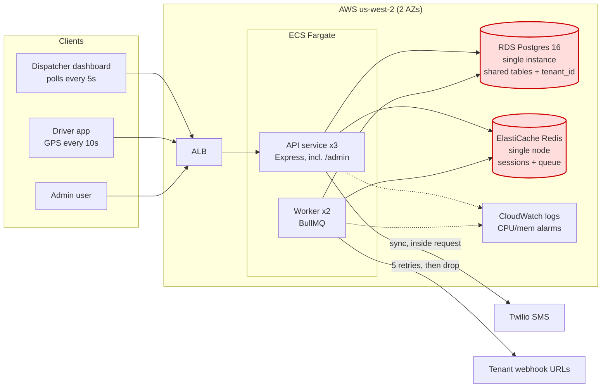
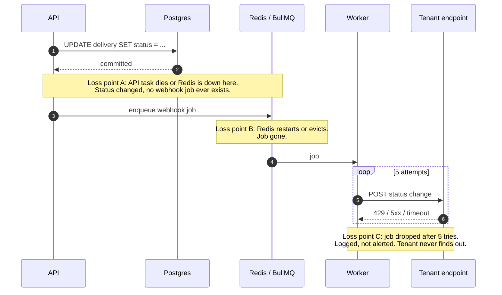
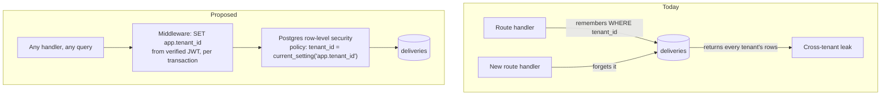
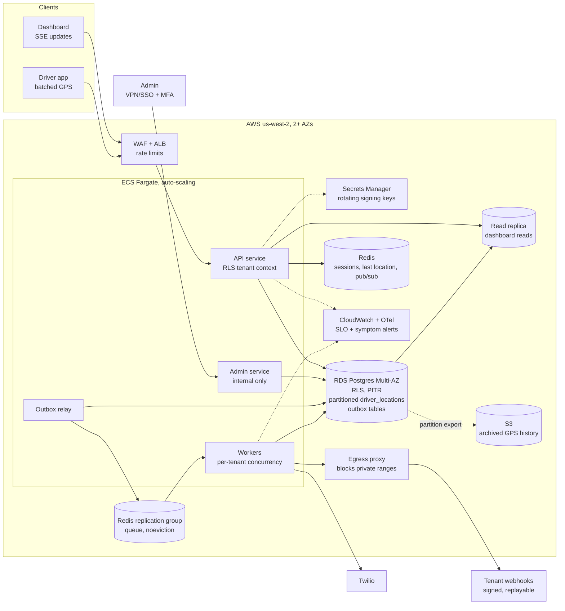

# Parcelly architecture review

## Bottom line

Parcelly is a sensible small-team design: a monolith API, a worker, managed Postgres and Redis. That shape is right for 4 engineers and should stay. The problems are not the shape. They are four specific gaps:

1. **The 99.9% promise isn't backed by the infrastructure.** Postgres and Redis are both single nodes in one AZ, and the only recovery path is a nightly snapshot that has never been restored. One bad hour on RDS breaks the monthly SLA (43 minutes of budget) on its own.
2. **Webhooks and SMS can be lost silently.** The writes to Postgres and the enqueue to Redis are separate steps, retries end in a drop, and nobody is alerted. This explains the biggest tenant's "missing webhooks."
3. **`driver_locations` grows without bound and shares the database with everything else.** Together with 5-second dashboard polling, this explains the lunch-peak slowdown, and it gets 10x worse at 400 tenants.
4. **Tenant isolation depends on every handler remembering `WHERE tenant_id = $1`.** One missed clause is a cross-tenant data leak. The JWT secret also signs admin tokens, so a leaked env var means full control of every tenant.

None of these needs a rewrite. Most of the fixes are configuration and two or three well-known patterns (outbox, partitioning, row-level security).

## Scorecard

| Area | Rating | Why |
|---|---|---|
| Availability / resilience | Poor | Single-AZ RDS, single-node Redis, untested restore, 99.9% contract |
| Data integrity | Poor | Dual writes (DB then Redis), webhooks dropped after 5 retries |
| Scalability (to 10x) | Weak | Unbounded GPS table, polling dashboard, Twilio in the request path |
| Security / tenant isolation | Weak | Isolation by convention, shared HS256 secret in env, admin in public API |
| Observability | Weak | No alerts on the failures customers notice, no tracing, unstructured logs |
| Simplicity / fit for team | Good | Monolith + worker on Fargate is the right call for 4 engineers |
| Delivery pipeline | Fair | Rolling deploys via GitHub Actions; no mention of migration safety or rollback |

## Current architecture

Red nodes are single points of failure.



## Findings, ranked

### 1. Critical: the data tier can't meet 99.9%

- **RDS is single-AZ.** An instance or AZ failure means waiting for AWS to replace it, or restoring a snapshot. Either can take well over 43 minutes.
- **Nightly snapshots mean up to 24 hours of lost deliveries** if you restore from one. Check whether automated backups with point-in-time recovery are on. If they are, your real RPO is about 5 minutes; if only snapshots are taken, it's a day.
- **The restore has never been tested.** You don't know how long it takes, whether it works, or who knows how to do it at 2 a.m.
- **Redis is a single node holding both sessions and the job queue.** If it restarts, every user is logged out and every queued webhook and ETA job is gone. If memory fills up and the eviction policy isn't `noeviction`, Redis can silently evict queued jobs to make room for sessions.

**Fix:** turn on RDS Multi-AZ (one setting, roughly doubles the RDS bill, 1 to 2 minute failovers). Confirm PITR is on. Do a timed restore into a scratch instance this month and write the runbook. Move Redis to a replication group with Multi-AZ and automatic failover, set `maxmemory-policy noeviction` on the queue's Redis, and ideally split sessions and the queue onto separate Redis instances (or move sessions out, see finding 6).

### 2. Critical: webhooks and SMS get lost

This is almost certainly why the largest tenant reports missing webhooks.



The biggest tenant sends the most events, so it's the most likely to rate-limit you (429) or have a slow endpoint during its own peaks. Five retries with BullMQ's default short backoff can burn through in seconds to minutes. Then the event is gone.

**Fixes, in order:**

- **Transactional outbox.** In the same transaction as the status update, insert a row into a `webhook_outbox` table. A worker reads unsent outbox rows and enqueues or sends them. This removes loss points A and B, because the event lives in Postgres, which is durable and backed up.
- **Never drop.** Use exponential backoff over hours (for example 1 min, 5 min, 30 min, 2 h, 6 h, 24 h). After that, mark the event `failed`, keep it, alert, and give tenants a replay button or endpoint.
- **Per-tenant concurrency limits** so one slow tenant can't fill the worker and delay everyone else's webhooks.
- **Include an event ID, a sequence number and a timestamp** in each payload. Retries make out-of-order delivery normal; tenants need a way to dedupe and order.
- **Sign payloads** with an HMAC per tenant so tenants can verify they came from you.
- **Give tenants a catch-up API** (`GET /events?since=...`) so a missed webhook is recoverable on their side too.

Apply the same outbox to the ETA job enqueued after dispatch.

### 3. High: Twilio inside the dispatch request

```mermaid
sequenceDiagram
    autonumber
    participant Disp as Dispatcher
    participant API
    participant PG as Postgres
    participant TW as Twilio
    participant R as Redis

    rect rgb(255,235,235)
    Note over Disp,R: Today
    Disp->>API: POST /deliveries
    API->>PG: INSERT delivery
    API->>TW: send SMS (blocks request)
    TW-->>API: slow / error / timeout
    API->>R: enqueue ETA job
    API-->>Disp: response (slow or 500)
    Note over Disp: Dispatcher retries -> duplicate delivery + duplicate SMS
    end

    rect rgb(235,255,235)
    Note over Disp,R: Proposed
    Disp->>API: POST /deliveries (Idempotency-Key)
    API->>PG: BEGIN; INSERT delivery; INSERT outbox(sms, eta); COMMIT
    API-->>Disp: 201 fast
    Note over PG,R: Outbox relay enqueues SMS + ETA jobs; worker calls Twilio with retries
    end
```

When Twilio is slow, dispatch is slow. When Twilio errors, the delivery row exists but the dispatcher sees an error, retries, and creates a duplicate. Move the SMS to the worker through the outbox and accept an `Idempotency-Key` header on create. Alert on SMS failure rates, since recipients not getting texts is a customer-visible failure.

### 4. High: `driver_locations` and dashboard polling will sink the database

**GPS volume, rough numbers:**

| | Today | At 400 tenants (10x) |
|---|---|---|
| Inserts/s at peak (all drivers active) | ~120 | ~1,200 |
| Rows/day (8-hour shifts) | ~3.5M | ~35M |
| Rows/year, no retention | ~1.3B | ~13B |

Every insert also updates indexes and generates WAL. The table keeps growing, vacuum falls behind, and any query that touches it gets slower every month.

**Dashboard polling:** every open dashboard hits `GET /api/deliveries?status=active` 12 times a minute, whether or not anything changed. With a few dispatchers per tenant that's tens of requests per second today and hundreds at 400 tenants, all landing on the same primary that's absorbing the GPS writes. At lunch, deliveries, GPS pings and dispatcher activity all peak together. That's the slowdown.

**Fixes:**

- **Partition `driver_locations` by day** (native Postgres partitioning or `pg_partman`). Set a retention policy (for example, 30 to 90 days hot, then export to S3 as Parquet if anyone needs history) and drop old partitions instead of deleting rows.
- **Keep a latest-position store** separate from history: a `driver_last_location` table updated with an upsert, or a Redis key per driver. The dashboard reads that, never the history table.
- **Batch GPS writes.** Have the driver app send pings in batches (for example every 30 s with three points), or have the API buffer and multi-row insert. Fewer, larger writes are much cheaper.
- **Index the dashboard query** with a partial index such as `(tenant_id, status) WHERE status = 'active'` and check its plan with `EXPLAIN ANALYZE` against production-sized data.
- **Stop blind polling.** Cheapest step: return `ETag` / `If-None-Match` or an `updated_since` cursor so most polls return 304 or an empty diff. Better: push changes over Server-Sent Events, fed by Postgres `LISTEN/NOTIFY` or Redis pub/sub. SSE works through the ALB and is simpler to run than WebSockets.
- **Add a read replica** once the above is done, and send dashboard reads there.

### 5. High: tenant isolation by convention

Every route handler must remember `WHERE tenant_id = $1`. With 4 engineers moving fast, someone will eventually forget it on a new endpoint, a report or an admin query, and one courier company will see another's customers. At 400 tenants, the chance and the blast radius both grow.



**Fix:** enable Postgres row-level security on every tenant table. Set `app.tenant_id` with `SET LOCAL` at the start of each transaction from the verified token, and have the app connect as a role that is subject to RLS (not the table owner, not a superuser). Keep the `WHERE` clauses too; RLS is the safety net. Add a test that runs each endpoint as tenant A against data from tenant B.

Also plan for the noisy-neighbor case: the biggest tenant is 30% of volume today, and the marketplace partnership could bring tenants larger than that. Add per-tenant rate limits on the API and per-tenant concurrency in the worker now, while it's cheap.

### 6. High: authentication and admin

- **The JWT secret is a plain ECS environment variable.** Anyone who can read the task definition, or any log that dumps the environment, has it. Because the same secret signs `is_admin` tokens, the secret is effectively the master key. Move it to Secrets Manager (injected via ECS `secrets`), and preferably switch to asymmetric signing (RS256/ES256) with key IDs so you can rotate without logging everyone out.
- **24-hour tokens with no revocation.** A stolen token, or a fired dispatcher, works for a day. Use short access tokens (15 minutes) plus refresh tokens you can revoke, or check a server-side session/version on each request. You already have sessions in Redis; use them deliberately.
- **Driver and dispatcher tokens are the same kind.** Add an `aud` or `role` claim and enforce it per route, so a driver token can never call dispatcher or admin endpoints.
- **`/admin` sits on the public API** behind one claim. Split it into a separate service, or at least a separate ALB listener reachable only via VPN/SSO, require MFA, and audit-log every admin action.
- **Email and password login** needs rate limiting and lockout at minimum. Offer MFA for tenant admins, and SSO later for larger marketplace tenants.
- **Webhook URLs are an SSRF risk.** The worker POSTs to any URL a tenant enters, from inside your VPC. Validate URLs (https only, resolve and block private, link-local and metadata ranges such as `169.254.0.0/16`), and ideally send webhooks through an egress proxy.

### 7. Medium: observability doesn't cover what customers feel

CPU and memory alarms tell you a box is busy, not that dispatchers can't work or texts aren't going out. Two people share on-call, so alerts need to be few and meaningful.

- **Alert on symptoms:** ALB 5xx rate, p95 latency on key routes, queue depth and oldest-job age, webhook failure rate per tenant, SMS failure rate, RDS CPU, connections, replica lag and free storage.
- **Define an SLO** (for example 99.9% of requests succeed under 1 s) and alert on error-budget burn rate instead of individual blips.
- **Structured JSON logs** with `tenant_id`, `request_id` and `delivery_id`, so you can answer "what happened to this delivery" in one query.
- **OpenTelemetry tracing** across API, queue and worker. AWS X-Ray or any hosted backend is fine.
- **A per-tenant webhook delivery log** visible to tenants, which also cuts support load.

### 8. Medium: deploys and operations

- Rolling updates are fine, but make database migrations backward-compatible (expand, then contract) so a rollback doesn't break on schema.
- Check that the ALB health check hits a real readiness endpoint, and that the ECS deployment circuit breaker with automatic rollback is on.
- Set ECS service auto-scaling on API and worker (CPU and queue depth), with a minimum spread across both AZs.
- Use RDS Proxy or a bounded connection pool per task. Scaling out API tasks under load can otherwise exhaust Postgres connections.
- Load test at 10x the current peak before the partnership launch, not after.

## Target architecture

Same shape, same team, no new paradigms. The changes are redundancy, an outbox, a split for hot location data, push instead of polling, and RLS.



## Roadmap

Sized for 4 engineers who also ship features.

**Next 30 days (resilience and silent failures)**
1. RDS Multi-AZ on, PITR confirmed, timed restore drill done and written up.
2. Redis replication group with failover; `noeviction` on the queue.
3. Webhooks: longer backoff, keep failed events instead of dropping, alert on failures. Tell the biggest tenant what you found.
4. Alerts on ALB 5xx, latency, queue age, webhook and SMS failure rates.
5. JWT secret into Secrets Manager; rotate it.

**Months 2 to 3 (scale and correctness)**
6. Transactional outbox for webhooks, SMS and ETA jobs. Twilio out of the request path. Idempotency keys on create.
7. Partition `driver_locations`, retention policy, latest-position store, batched pings.
8. Dashboard: partial index, then `updated_since` or SSE.
9. Postgres RLS on all tenant tables, plus cross-tenant tests.
10. Webhook signing, event IDs, replay endpoint, SSRF protection.

**Months 4 to 6 (ready for 400 tenants)**
11. Short-lived tokens with refresh and revocation; role/audience claims; admin split out behind SSO and MFA.
12. Per-tenant rate limits and worker concurrency.
13. Read replica for dashboard reads; RDS Proxy.
14. Structured logs and OpenTelemetry tracing.
15. Load test at 10x peak; fix whatever breaks first.

## What not to do

- **Don't split into microservices.** Four engineers and two on-call people can't run them well, and none of the problems above come from the monolith.
- **Don't move to Kafka or a new database for GPS yet.** Partitioned Postgres plus a latest-position store handles 10x comfortably. Revisit only if load tests prove otherwise.
- **Don't go multi-region for 99.9%.** Multi-AZ done properly is enough for that target and far cheaper to operate.
- **Don't do database-per-tenant.** At 400 tenants it multiplies migrations and operations. Shared tables with RLS is the right model at this size.

## Assumptions

- All 1,200 drivers can be active at peak, on roughly 8-hour shifts.
- A few dispatchers per tenant keep the dashboard open during working hours.
- BullMQ defaults are in use (short backoff), and webhook payloads are not currently signed. The overview doesn't say either way.
- "Nightly automated snapshots" may or may not include point-in-time recovery; check the RDS backup settings.
